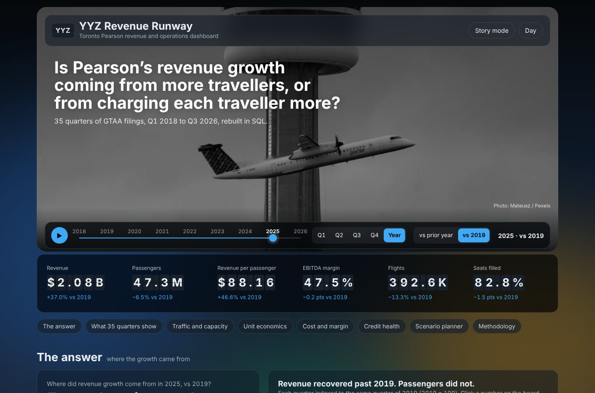
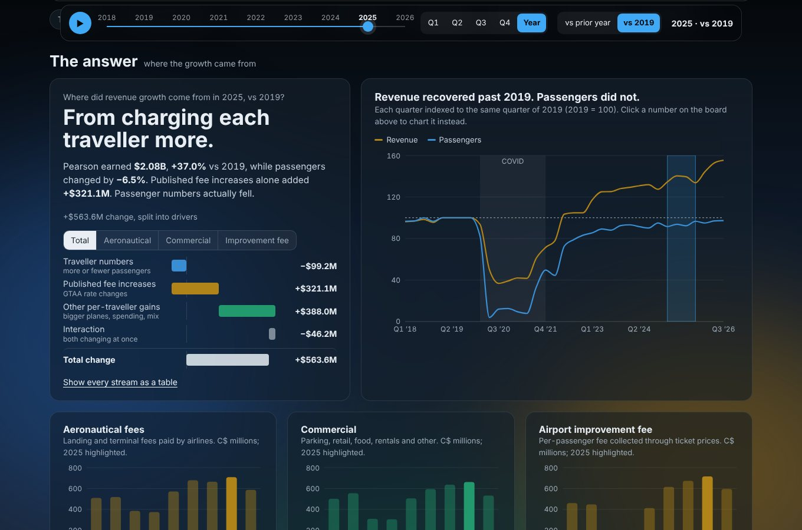
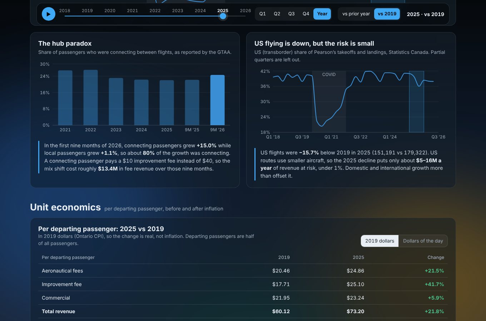
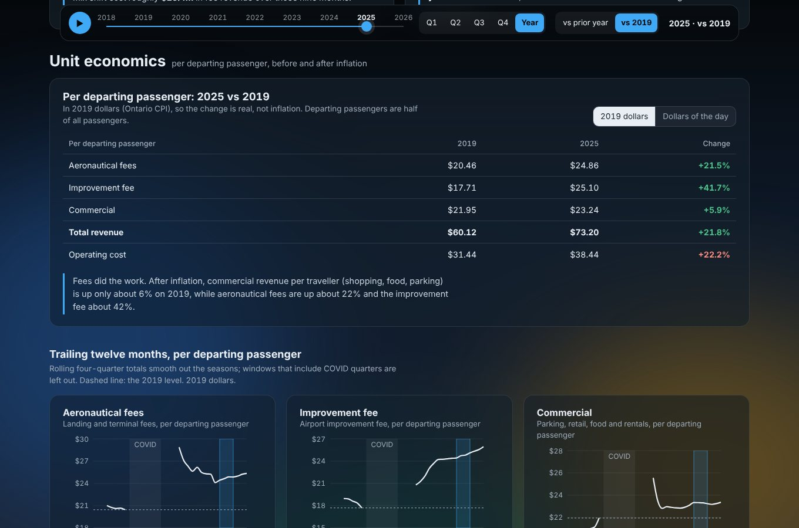
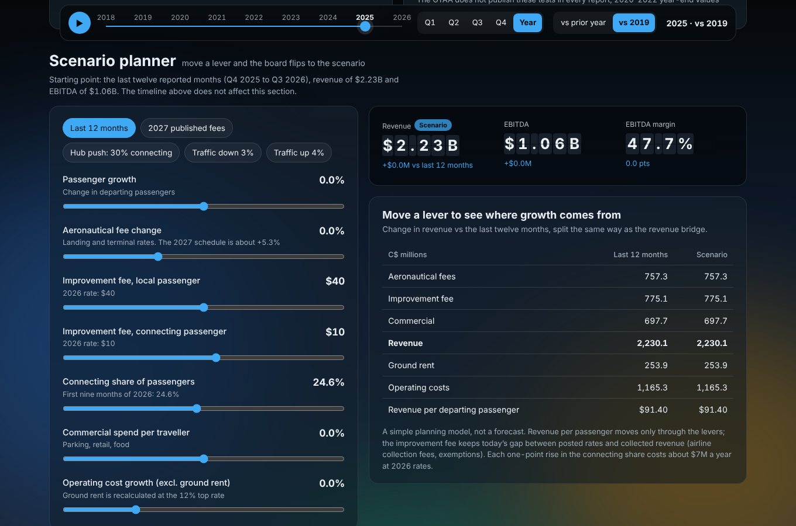
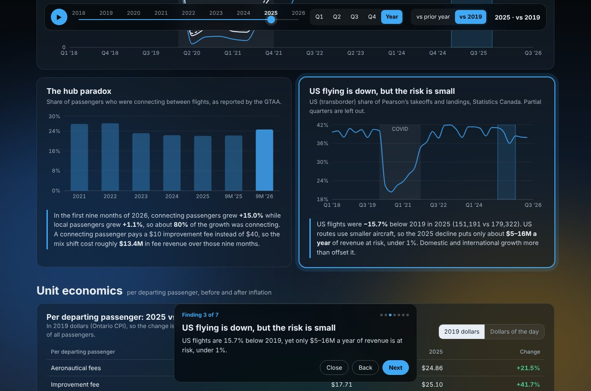
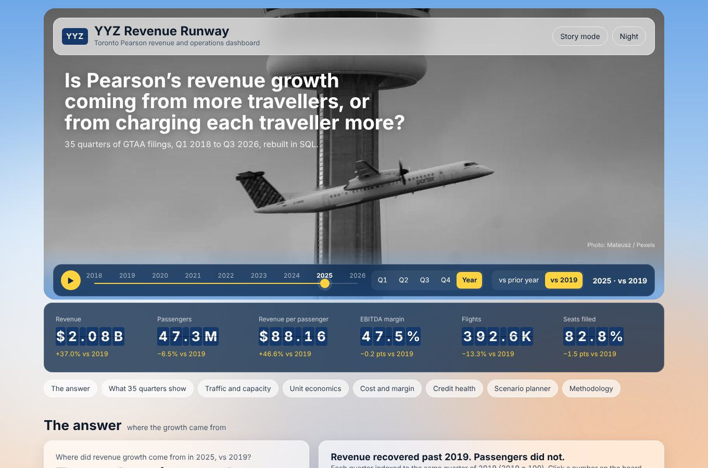

# YYZ Revenue Runway

**Toronto Pearson Revenue & Operations Dashboard: is revenue growth coming from more travellers, or from charging each traveller more?**

A revenue analysis of Toronto Pearson International Airport (YYZ) over 35 quarters, Q1 2018 to Q3 2026. It rebuilds the airport's finances from the Greater Toronto Airports Authority's (GTAA) own quarterly filings, splits every period's revenue change into traveller numbers versus price, and follows the money through costs, margins and debt. The results ship as an interactive dashboard built for an airport revenue team.

> **About the data:** GTAA quarterly and annual Management's Discussion and Analysis reports (35 reports, Q1 2018 to Q3 2026) and aeronautical fee schedules (2018 to 2027), plus Statistics Canada tables 23-10-0008-01, 23-10-0302-01 and 18-10-0004-01. This is real, public, published data; every figure in the findings is traced to a report and PDF page. Independent analysis, not affiliated with the GTAA or Toronto Pearson. All dollar figures are Canadian dollars.

**Tools:** Python (pandas, pdfplumber, Tesseract OCR) · PostgreSQL (Supabase) · React + Vite + Recharts (live dashboard on Vercel)
**Techniques:** PDF table extraction with self-checking arithmetic, restatement handling, SQL window functions (`LAG`, framed `SUM`, named windows), price/volume revenue bridge, inflation adjustment, trailing-twelve-month credit metrics, independent reconciliation in Python

---

## [Live dashboard: YYZ Revenue Runway](https://yyz-revenue-runway.vercel.app) · [Full findings](FINDINGS.md)



---

## The headline

| Metric | Value |
|---|---|
| Quarters analysed | 35 (Q1 2018 to Q3 2026), 35 GTAA reports |
| Revenue, 2025 vs 2019 | **$2.08B, +37.0% (+$563.6M)** |
| Passengers, 2025 vs 2019 | 47.3M, **−6.5%** |
| Share of the growth from published fee increases | **57% ($321.1M)** |
| Revenue lost to fewer travellers | −$99.2M |
| Connecting passengers' share of 2026 growth (first nine months) | about **80%** |
| Revenue at risk from the US-flight slowdown | $5–16M a year (under 1%) |
| EBITDA margin, 2019 → 2025 | 47.7% → **47.5%** |

**The conclusion in one sentence:** Pearson's revenue rose 37% from 2019 to 2025 on 6.5% fewer passengers, and a SQL revenue bridge traces 57% of the $564M growth to published fee increases; the extra revenue per traveller went into higher costs, not a wider margin, so the next lever is cost and volume, not another rate increase.

---

## Contents

- [Business context](#business-context)
- [Business questions](#business-questions)
- [The dataset](#the-dataset)
- [Analysis walkthrough](#analysis-walkthrough)
- [The dashboard](#the-dashboard)
- [Exceptions and limitations](#exceptions-and-limitations)
- [Recommendations](#recommendations)
- [Method](#method)
- [Repository structure](#repository-structure)
- [About](#about)

---

## Business context

Toronto Pearson is Canada's busiest airport and a not-for-profit authority funded entirely by its users: airlines pay landing and terminal fees, passengers pay an airport improvement fee in every ticket, and shops, restaurants and parking pay commercial rents. Since the pandemic its revenue has recovered far faster than its traffic. A revenue team needs to know why, because growth bought with higher fees has a ceiling that growth from more travellers does not.

The stakeholder framed here is the **Director of Revenue at an airport authority**, reporting to the VP Finance, who needs to explain where growth came from, what is driving cost per passenger for airlines, and where the next dollar of growth should come from.

## Business questions

1. **The answer:** is revenue growth coming from more travellers, or from charging each traveller more?
2. **The mix:** how do connecting passengers, US flights and inflation change that picture?
3. **The bottom line:** did higher revenue per traveller widen the margin, and what does it mean for debt and the next pricing decision?

## The dataset

**Source:** 35 GTAA quarterly and annual MD&A reports (PDF), the GTAA's aeronautical fee schedules, and three Statistics Canada tables (aircraft movements by sector and Ontario CPI).

**Why this dataset:** the GTAA is the only source that reports Pearson's revenue, costs, passengers, seats and debt every quarter, and its filings are public. Statistics Canada adds what the GTAA doesn't report: US (transborder) flights and inflation.

| | |
|---|---|
| Reports extracted | 35 quarterly and annual MD&As, 2018 Q1 to 2026 Q3 |
| Grain | one row per quarter; 75 columns (revenue lines, costs, traffic, debt, covenants, flags) |
| Scanned or unreadable PDFs | 2 (Q1 2023 and Q3 2021), read with OCR and cross-checked |
| Restated figures | the next year's prior-year column is used where the GTAA restated a number |
| Q4 | the annual figure minus the first nine months |
| Flags | COVID (2020–21), Omicron (Q1 2022), Q4 2020 ground-rent relief, partial StatCan quarters |

**Validation:** revenue and cost lines add up to their totals in all 35 quarters; four quarters add up to the annual report in all 8 full years; Statistics Canada movements are within about 1% of the GTAA's in all 34 complete quarters; 13 of 13 control totals from the SQL views match an independent Python recalculation.

## Analysis walkthrough

### Step 1 — Acquire the reports (Python)

Downloaded every GTAA quarterly and annual report and fee schedule from the GTAA's investor-relations pages and the Statistics Canada tables through its web data service, then extracted the text page by page, with OCR for the two scanned reports. See [`scripts/00_download_and_text.py`](scripts/00_download_and_text.py) and [`scripts/00b_statcan.py`](scripts/00b_statcan.py).

### Step 2 — Extract and self-check every figure (Python)

Pulled each table value with its prior-year comparative and the PDF page it came from. Every line is checked with its own arithmetic (current − prior = reported change), which caught footnote markers, typos and scanned digits. See [`scripts/01_extract_gtaa.py`](scripts/01_extract_gtaa.py) and [`scripts/02_build_quarterly.py`](scripts/02_build_quarterly.py).

### Step 3 — Clean and explore (Python)

Built one row per quarter, joined fee rates and the Ontario CPI deflator (2019 = 1.00), derived per-passenger metrics and checked them against the GTAA's published figures. See [`notebooks/01_clean_and_explore.ipynb`](notebooks/01_clean_and_explore.ipynb).

### Step 4 — Model in SQL (PostgreSQL/Supabase)

Loaded the table with row-level security and built the analysis as views: year-over-year and vs-2019 changes with `LAG() OVER (PARTITION BY quarter ORDER BY year)`, trailing-twelve-month totals with framed windows (`ROWS BETWEEN 3 PRECEDING AND CURRENT ROW`), and debt per passenger rebuilt to within $1 of the GTAA's own figure. See [`sql/03_yoy_and_vs2019.sql`](sql/03_yoy_and_vs2019.sql) and [`sql/04_trailing_12_months.sql`](sql/04_trailing_12_months.sql).

### Step 5 — Build the revenue bridge

For each stream (aeronautical fees, improvement fee, commercial), revenue = departing passengers × revenue per departing passenger. The change between two periods splits into traveller numbers, published fee increases, other per-traveller gains and an interaction term that add up exactly. See [`sql/05_revenue_bridge.sql`](sql/05_revenue_bridge.sql).

### Step 6 — Reconcile

Recomputed 13 control totals in pandas, independently of SQL; all match. See [`sql/06_reconciliation.sql`](sql/06_reconciliation.sql) and [`scripts/05_reconcile_sql.py`](scripts/05_reconcile_sql.py).

### Step 7 — Test the findings

Seven findings, each with its query and a GTAA page reference, in [`FINDINGS.md`](FINDINGS.md) and [`sql/07_findings.sql`](sql/07_findings.sql).

### Step 8 — Ship it as a dashboard (React)

Exported the SQL views to static JSON ([`scripts/06_export_app_data.py`](scripts/06_export_app_data.py)) and built a one-page React dashboard deployed on Vercel, so the numbers can be explored for any year and quarter instead of read in a report.

---

## The dashboard

**Use it live:** **[yyz-revenue-runway.vercel.app](https://yyz-revenue-runway.vercel.app)**. Screenshots below in case the link is ever down.

- **Timeline and split-flap KPI board:** pick any year or quarter (or press play to run 2018 to 2026) and compare with the prior year or 2019; the six key numbers flip like a departure board, and clicking one charts it.
- **The answer:** a plain-English verdict for the chosen period and the revenue bridge, by stream.



- **Traffic and capacity:** fewer, fuller, bigger flights; the hub paradox; US flying.



- **Unit economics:** revenue and cost per departing passenger in 2019 dollars, and airline cost per passenger against announced rate increases.



- **Cost and margin, credit health,** and a **scenario planner** where passenger growth, fees, the connecting share and costs can be changed to see next year's revenue and margin.



- **Story mode** walks through the seven findings one by one, setting the period and pointing at the chart that proves each one. Hovering a chart shows the GTAA report and page behind each quarter.



It has a night theme (default) and a day theme, and works on a phone:



---

## Exceptions and limitations

- **Estimates:** revenue at risk from US flights, the improvement fee given up through the passenger mix, and airline cost per passenger before 2023 are derived, not reported. Each assumption is stated in [FINDINGS.md](FINDINGS.md).
- **Published price effect** uses the GTAA's stated annual change in aeronautical rates and the posted local improvement-fee rate; fees outside the stated change fall into "other per-traveller gains".
- **COVID:** 2020–2021 are shown but price/volume splits are hidden for comparisons involving them; Q1 2022 (Omicron) and the Q4 2020 ground-rent credit are flagged.
- **Q4 2026** is not yet published (expected around March 2027), so 2026 is shown as nine months and compared with the same nine months.
- **Passenger mix** (local vs connecting) is the GTAA's estimate and is published only from 2021.
- **Rounding:** passengers are published to 0.1M, so per-passenger values in small quarters move with rounding.
- **Statistics Canada** had not published September 2026 at the time of analysis, so US-flight comparisons for Q3 2026 are left out.

## Recommendations

| # | Action | Basis |
|---|---|---|
| 1 | Plan future growth on **volume, not further rate increases** | Fee increases drove 57% of growth since 2019; in 2026 volume contributes as much as price for the first time |
| 2 | **Put a number on passenger mix in every improvement-fee forecast** | Each one-point rise in the connecting share costs about $7M a year at 2026 rates |
| 3 | Treat the US slowdown as a **watch item, not a revenue crisis** | Under 1% of revenue at risk; it matters more for network strategy than for this year's budget |
| 4 | Make **cost** the next lever | Margins haven't moved since 2019 (47.7% → 47.5%) and cost per traveller rose 22% after inflation |

Detail and evidence for each recommendation are in [FINDINGS.md](FINDINGS.md#what-this-means-for-revenue-leadership).

## Method

**Approach:** frame the revenue question → extract every figure from the source filings with its page → check each number against its own arithmetic and the published totals → model in SQL with window functions → split growth into volume and price → reconcile independently → ship it as a dashboard.

**Techniques used:**

| Technique | Applied in |
|---|---|
| PDF download, text extraction and OCR | `scripts/00_download_and_text.py` |
| Table extraction with self-checking arithmetic and restatement handling | `scripts/01_extract_gtaa.py`, `scripts/02_build_quarterly.py` |
| Cross-source validation (GTAA vs Statistics Canada) | `scripts/03_statcan_quarterly.py` |
| Schema design and row-level security | `sql/01_schema.sql`, `sql/02_load_checks.sql` |
| Year-over-year and vs-2019 changes with `LAG` and named windows | `sql/03_yoy_and_vs2019.sql` |
| Trailing-twelve-month metrics with framed windows | `sql/04_trailing_12_months.sql` |
| Price/volume revenue bridge | `sql/05_revenue_bridge.sql` |
| Independent reconciliation in pandas | `sql/06_reconciliation.sql`, `scripts/05_reconcile_sql.py` |
| Interactive dashboard (React, Vite, Recharts) | `web/` |

## Repository structure

```
yyz-revenue-runway/
├── README.md                       # This file
├── FINDINGS.md                     # Seven findings, recommendations, limitations, with GTAA page references
├── scripts/
│   ├── 00_download_and_text.py     # GTAA reports and fee schedules, text extraction, OCR
│   ├── 00b_statcan.py              # Statistics Canada movements and CPI
│   ├── 01_extract_gtaa.py          # Every table value with its source page and self-check
│   ├── 02_build_quarterly.py       # One row per quarter, restatements, tie-out checks
│   ├── 03_statcan_quarterly.py     # StatCan quarterly roll-up and cross-check
│   ├── 04_fee_rates.py             # Fee schedule rates and stated annual changes
│   ├── 05_reconcile_sql.py         # Independent pandas recalculation of the SQL control totals
│   └── 06_export_app_data.py       # SQL views to the dashboard's JSON
├── notebooks/
│   └── 01_clean_and_explore.ipynb  # Derived metrics, deflator, sanity checks, charts
├── sql/
│   ├── 01_schema.sql               # Tables (safe to rerun)
│   ├── 01b_seed_data.sql           # Generated inserts
│   ├── 02_load_checks.sql          # Load checks and row-level security
│   ├── 03_yoy_and_vs2019.sql       # View v_quarterly_changes
│   ├── 04_trailing_12_months.sql   # View v_ttm
│   ├── 05_revenue_bridge.sql       # View v_revenue_bridge
│   ├── 06_reconciliation.sql       # Control totals
│   └── 07_findings.sql             # The queries behind each finding
├── data/
│   ├── raw/                        # Extracted values and StatCan tables (PDFs re-downloaded by script)
│   └── processed/                  # kpi_quarterly.csv, passenger_mix.csv, reconciliation.csv
├── web/                            # The live dashboard (React + Vite, deployed on Vercel)
│   ├── src/
│   ├── public/data/app_data.json   # Snapshot of the SQL views
│   └── package.json
└── assets/                         # Screenshots
```

**Run the dashboard locally:** `cd web && npm install && npm run dev`

**Reproduce the data:** run `scripts/00` to `04`, the notebook, then `sql/01` to `06` in PostgreSQL, then `scripts/05` and `scripts/06` (`DATABASE_URL` points at the database).

Photo in the dashboard: a Porter Dash 8 passing the CN Tower by Mateusz, [Pexels](https://www.pexels.com/photo/17796157/) (Pexels License).

---

## About

**Shubham Sarje** — Data & Business Analyst, Toronto

**Approach:** Start from the question a revenue team is actually asking, rebuild the numbers from the source filings, and check every figure before it reaches a chart.

**Background:** Accounting-trained (B.Com) with dual post-graduate analytics credentials (4.0 GPA, Durham College) — which is why margin, cost structure, and profitability analysis are natural territory. Currently a Technical & Customer Experience Analyst at Transcom.

**Toolkit:** SQL (PostgreSQL) · Power BI · Tableau · Excel *(certified)* · Python

[LinkedIn](https://linkedin.com/in/shubhamsarje) · shubham.s.sarje@gmail.com · Toronto, ON
